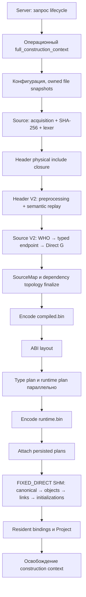

# Аудит текущей архитектуры — 23 октября 2026

## Область и основной вывод

Проверены Server/Project ownership, границы PUBLISH/REBUILD/BUILD/LOAD,
приобретение файлов, frontend, WHO/String IDs, Graph/SourceMap, persistence,
физические планы и resident materialization. Это обзор конструкции и производительности,
а не полный аудит сетевых протоколов, авторизации, конкурентности сервера или безопасности.
Исполняемый код в рамках этого аудита не менялся.

**Основа архитектуры правильная: один semantic G, identity_ref как WHO, отдельные
физические WHERE и FIXED_DIRECT Runtime. Сейчас главный недостаток — суммарная
стоимость последовательных стадий жизненного цикла, а не отсутствие ещё одного Parser.**
Новые данные расширяют прежний аудит `PUBLISH_ARCHITECTURE_REVIEW_22.md`.

## Фактический путь

Диаграмма показывает зависимости крупных стадий, а не отсутствие внутреннего
параллелизма. Внутри acquisition/lexing, first-touch, планирования и materialization
уже работают execution lanes. Source preparation overlap с Header по умолчанию выключен.

## Что сохраняем

1. `server_context` владеет resident Project; temporary construction state туда
   не переносится. `nullptr` обозначает UNLOADED (`server_context.hpp`).
2. `file_id`, `string_id`, `identity_ref` и Graph handles имеют разные обязанности.
   WHO — семантическая сущность, handle — физическое место. Дополнительная локальная
   WHO database дублировала бы существующую модель.
3. Header V2 и Source V2 изменяют **один G**. Production уже имеет Direct G;
   новый Local G или промежуточная semantic model не являются недостающей стадией.
4. Owned snapshots сохраняют стабильные байты и lifetime views; произвольное
   повторное чтение файлов во время Parser нарушило бы этот контракт.
5. Source last-write-wins, stable target slots, warnings и provenance остаются
   частью контракта. Их нельзя отождествлять с выполнением C++-выражений.
6. Физические runtime plans сохраняются и подключаются. Resident-публикация не
   повторяет полноценную подготовку ABI/type/link plans.
7. PUBLISH: change tokens выключены, BUILD acceleration capture выключен,
   явный durable flush выключен. Убирать USN/Flush ещё раз нечего.
   Отсутствие явного flush не исключает page faults или фоновой записи ОС.

## Где проходит время

48 control-вызовов текущего frozen V2 из серии ETW, без активного sampling во время
самих control-вызовов. Система дрейфовала; это описательная картина этой серии,
не новое сравнение производительности. Медианы отдельных стадий не складываются
в точную медиану полного времени.

| Стадия | Медиана, мс |
| --- | ---: |
| Полный PUBLISH | 1425,75 |
| Конфигурация | 26,13 |
| Initial Source lexical, включая acquisition | 184,93 |
| Header physical preparation | 68,31 |
| Header semantic | 215,15 |
| Source | 456,69 |
| Persistence и физические планы | 210,49 |
| Resident publication | 203,20 |
| Освобождение temporary context | 22,43 |

Header physical/semantic и Source вложены в semantic_ms; не прибавлять их к
semantic_ms повторно. Persistence subtimers также имеют собственные границы.
Unaccounted median: 0,005 мс; крупной скрытой паузы между таймерами здесь не видно.

Внутри persistence: compiled encode ~67,10 мс, ABI layout ~14,79 мс,
параллельные physical plans ~87,62 мс, создание/first-touch compiled ~13,63 мс.
Compiled structural bind ~0,001 мс: повторный bind не объясняет сотни миллисекунд.
Flush timer равен нулю, как и требует режим PUBLISH.

Грубая иллюстрация бюджета: уменьшение Header semantic и Source вдвое сэкономило
бы около 336 мс на этих ориентирах, оставив примерно 1,09 секунды. Это не прогноз
и не сумма точных парных эффектов. Оно показывает, почему путь <1 с нельзя
обосновать одними микрооптимизациями lookup.

## Доказанные ограничения и следующие проверки

### 1. Acquisition включает существенный SHA-256 CPU

В полном профиле `sha256_state::transform` имеет 12333 exclusive samples,
`hash_file_content` — ещё 4313. Это разные leaf samples, их можно складывать как
CPU samples, но нельзя превращать в wall time. 12270 transform samples имеют
ближайшего отличающегося caller `hash_file_content`; сам `hash_file_content`
имеет caller `acquire_windows_snapshot` во всех своих 4313 exclusive samples.

`file_identity.cpp` использует собственную SHA-256 реализацию: побайтовый update,
затем transform 64-байтовых блоков. Windows snapshot вычисляет digest даже при
выключенном capture_change_token. Это **content SHA-256**, не identifier hash Lexer.

Первый приоритет: FILE-SNAPSHOT-HASH-01. Проследить потребителей digest отдельно
для Project configuration proofs и ordinary Header/Source snapshots. Проверить,
какая работа действительно нужна PUBLISH, а какая наследуется от BUILD-контракта.
Не объявлять digest ненужным по факту выключенного USN. Если он необходим,
проверить более эффективную реализацию того же SHA-256 с теми же байтами результата.
Сначала consumer/lifetime audit, затем один A/B; пропуск digest и замена SHA backend
не должны смешиваться в одном эксперименте.

### 2. Runtime выполняет программу типов для каждого объекта

`shm_type_batch_executor::apply_api_one`: 26653 exclusive CPU samples; ближайший
caller во всех этих samples — `objects_object_major_range`. Это уже более точная
атрибуция, чем имя STL-функции после ICF.

Функция на каждом вызове проверяет ranges неизменяемого type API, затем выполняет
references, stores, children, repeats и post-stores. Это не простое копирование
готового образца. Objects уже выполняются параллельно; добавление ещё workers
не является достаточным архитектурным решением.

Следующий диагностический этап: RUNTIME-EXECUTOR-COST-01. Отделить стоимость
проверок неизменяемой программы от address-dependent checks, фактических writes,
рекурсии, first-touch и распределения объектов. Возможность проверить immutable
program один раз и исполнять проверенный план — кандидат, не утверждённая замена.
Bounds, pending links и порядок defaults/Source initialization должны сохраниться.
26653 CPU samples не означают 26653 мс wall-time потенциала: работа параллельна.

### 3. Барьеры есть, но часть зависимостей необходима

Source semantic replay ждёт Header types. Persistence ждёт final G. Physical plans
читают compiled view. Resident ждёт готовый runtime image. Замена WHO или добавление
общей concurrent map не снимает эти зависимости.

Header chunk experiment доказал параллельное extraction для проверенной projection,
но сквозной новый pipeline до G проиграл V2. Не переносить изолированные 65/145 мс
на production Header или суммировать эффекты разных экспериментов.

Сейчас менять крупные барьеры раньше проверки SHA/runtime executor не обосновано.
Overlap допустим только для read-only работ с явным lifetime и парным end-to-end A/B.

### 4. Lifetime увеличивает пик памяти

`full_construction_context` сохраняет files, lexical, strings, identities, G,
SourceMap и assigns до завершения resident publication. Уже готовые compiled/runtime
артефакты и новый SHM некоторое время сосуществуют с construction state.
Source ready-token storage частично освобождается раньше, но весь context — позднее.

Это подтверждённое перекрытие lifetime, а не доказанная утечка. Стоит отдельно
проверить безопасное освобождение больше не нужных construction arrays после
persistence и до SHM materialization. Цель прежде всего peak memory; перенос
destructor сам по себе не убирает его время из полного PUBLISH. Нужен анализ
borrowed spans и REBUILD consumers до любого изменения.

### 5. Разные semantic backends по режимам

PUBLISH использует Header/Source V2, тогда как REBUILD и incremental BUILD имеют
другие semantic backends. Комментарий об общей full-construction оболочке не
означает один Parser во всех режимах (`parser.cpp`).

Риск — дрейф семантики и diagnostics между режимами. Нужна матрица oracle fixtures
PUBLISH/REBUILD/BUILD с проверкой semantic values, WHO stability согласно режиму,
origins и first diagnostic. Простое сравнение двух полных файлов между разными
режимами не заменяет этот контракт: acceleration/lineage и порядки могут отличаться.

### 6. Экспериментальная поверхность усложняет сопровождение

CMake и Parser содержат старые/опциональные paths, документация смешивает target,
projection и production результаты. Snapshot конкретного executable и CMake cache
обязателен для интерпретации benchmark. Часть standalone экспериментов повторно
линкует production object files: это допустимо при неизменном ABI, но источники
объектов должны фиксироваться отдельно от нового graph.cpp/string_table.cpp.

Не удалять рабочие fallbacks под видом ускорения. Отделять архивные эксперименты
и их результаты от production defaults. Последние link-index 4x и intern-slot
кандидаты не получили доказанного full-PUBLISH выигрыша и остаются выключенными.

## Не предлагаемые изменения

- Не менять `identity_ref` и не вводить дополнительную WHO/type database.
- Не возвращать Source dispatcher/window и тяжёлую промежуточную модель.
- Не удалять SourceMap по низкой доле CPU: он обеспечивает origins/diagnostics.
- Не дублировать Graph indices в Parser.
- Не удалять structural checks или snapshot consistency checks без контракта.
- Не объявлять весь runtime этап лишним: PUBLISH возвращает resident Project,
  поэтому готовые файлы ещё не являются завершением операции.

## Рекомендуемый порядок

1. FILE-SNAPSHOT-HASH-01: потребители digest и точная стоимость acquisition lifecycle.
2. RUNTIME-EXECUTOR-COST-01: reuse immutable validation, execution и first-touch.
3. CONSTRUCTION-LIFETIME-01: пик памяти до materialization и безопасное раннее release.
4. После этого пересмотреть physical-plan metadata traversal и compiled encoding.

Каждый пункт — отдельный эксперимент с полным PUBLISH как основным endpoint.
Цель <1 с остаётся неподтверждённой. Следующий крупный выигрыш нельзя обещать
на основании CPU samples или одного сокращённого прохода.

## Источники доказательств

- `server_engine/project/project_full_construction.cpp`: orchestration, mode policies,
  persistence и resident transition.
- `server_engine/project/parser/parser.cpp`: actual backend selection и semantic order.
- `server_engine/project/file/file_context.cpp`, `file_identity.cpp`: acquisition policies.
- `server_engine/project/runtime/project_runtime.cpp`: persisted plan attach и SHM phases.
- `server_engine/project/shm/shm_type_batch.cpp`: `apply_api_one`.
- `server_engine/project/project_lifecycle_context.hpp`: ownership/lifetime.
- `build/source-cpu-sampling-02/capture-20261023-125921/`: полный ETW dataset.
- `build/architecture-review-20261023/evidence.json`: control medians, global exclusive
  leaves и caller attribution, извлечённые из этого dataset.

ETW limitations остаются прежними: 336 missing-stack samples из 359920,
нулевые event/buffer losses, matching PDB, IPO/ICF attribution limitations;
строгий zero-missing-stack gate не пройден. CPU и wall time не смешиваются.
