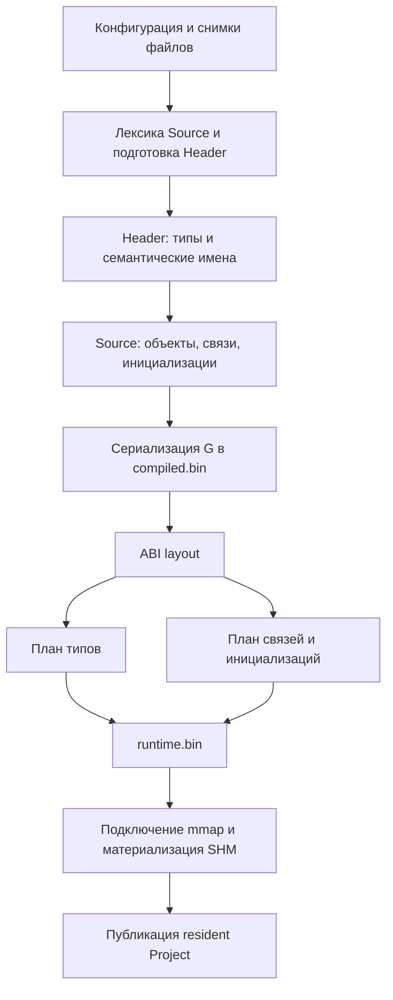

# Обзор архитектуры Server / Project / PUBLISH

Проверена текущая реализация, а не только целевая схема из документации.
Область: владение Server/Project, границы PUBLISH/BUILD/REBUILD/LOAD, физический
frontend, семантический Graph, сохранение физических планов и материализация
resident Runtime. Это не полный аудит сети, лицензирования или безопасности.
Изменений исполняемого кода в рамках обзора нет.

Уточнение после проверки identity-представлений: ключевые ссылки WHO уже
мигрированы в реализации. Аудит и вариант разделения Source resolver / commit
приведены в `PUBLISH_IDENTITY_PIPELINE_23.md`. Исторические описания
«Current implementation» в target-документе не отражают состояние этих полей.

## Текущая цепочка

Основные барьеры находятся в `project_full_construction.cpp`, семантическая
очерёдность — в `parser/parser.cpp` и `parser/source_parser_v2.cpp`.
Конфигурационные зависимости и Header preprocessing задают порядок; произвольная
перестановка файлов меняет семантику.

## Что уже устроено правильно

- `server_context` хранит один resident Project; временный компилятор принадлежит
  операции. `nullptr` соответствует UNLOADED.
- Разделены физический файл (`file_id`), текст (`string_id`), семантическая
  сущность (`identity_ref`) и физическое размещение в G.
- Семантический Graph один. BUILD отдельно владеет происхождением результатов и
  данными для инкрементальности.
- PUBLISH не собирает USN/change tokens и не делает явный durable flush.
- LOAD подключает сохранённые ABI/type/link планы из `runtime.bin`.
  Полного повторного построения этих планов при resident-публикации нет.
- Нативный runtime использует FIXED_DIRECT; перенос хеш-таблиц имён в цикл
  исполнения не нужен.

Переоткрытие двух mmap после сохранения само по себе не доказано как существенный
источник задержки. Оптимизировать его раньше семантического пути нецелесообразно.

## Где находится время

Ориентиры из трёх baseline `publish-stage` запусков эксперимента 21, уже с
принятым Source prehash, Release + IPO без PGO. Это одна серия; вложенные таймеры
не складываются второй раз.

| Участок | Примерно, мс |
|---|---:|
| Начальная подготовка файлов / Source lexical | 172 |
| Физическая подготовка Header | 74 |
| Семантика Header | 218 |
| Source вместе с prehash и освобождением его буферов | 462 |
| Сохранение compiled/runtime и построение физических планов | 203 |
| Resident-публикация | 201 |
| Полный PUBLISH | 1404 |

Около 74 мс остаётся на конфигурацию, прочие операции, промежутки между
перечисленными фазами и завершение lifetime. Нельзя объявлять эту разницу временем
одного деструктора без отдельного измерения.

## Архитектурные ограничения

1. **Параллельные участки соединены последовательными барьерами.** Source ждёт
   весь Header; сериализация ждёт весь Source; физические планы читают уже
   закодированный compiled view; resident ждёт runtime.bin. Локальное добавление
   потоков не сокращает всю эту цепочку.

2. **В Source смешаны чтение синтаксиса, разрешение имён, проверка типов и
   изменение G.** Главный цикл обходит корни последовательно. Порядок определяет
   string_id, видимость объявлений, extern, предупреждения и last-write-wins.
   Просто распараллелить parse(root) нельзя. Предыдущие Source Model и endpoint
   cache варианты добавляли работу, сохраняя значительную часть прежнего пути.

3. **Подготовка Source сейчас дважды читает компактную лексику.** Начальный lexer
   создаёт lexical words; после Header отдельные workers декодируют их и считают
   хеши для prepared tokens. Эксперимент 20 дал небольшой выигрыш, но не убрал
   первый проход. Следующее естественное направление — выдавать нужные Source
   метаданные прямо из первого lexer-прохода и измерять всю операцию вместе с
   дополнительной памятью. Глобальные ID по-прежнему назначаются последовательно.

4. **Строка char[N] разворачивается в N отдельных операций Graph.** В диагностике
   проекта было 508768 инициализаций элементов от 15899 строк. Кандидат на
   изменение алгоритма — пакетная запись уже проверенной строки/диапазона.
   Сначала можно сохранить прежний формат G и точный порядок записей, объединяя
   резервирование и обходы. Сжатая range-запись потребует изменения формата,
   BUILD-замен и runtime-планировщика; это отдельная миграция.

5. **Runtime исполняет компактные программы типов, а не только копирует байты.**
   `shm_type_batch.cpp::apply_api_one` повторяет проверки диапазонов и выполняет
   операции для каждого применения API. Кандидат — однократная валидация
   неизменяемой программы и подготовленный executor. Проверки адресов, зависящие
   от конкретного объекта, остаются необходимыми. Нельзя просто убрать проверки
   mmap-данных. Выигрыш ещё не измерен.

6. **Construction-состояние живёт до завершения resident-публикации.** Временные
   G/строки/лексика остаются во `full_construction_context`, пока создаётся SHM
   около 2.15 GB. Более раннее завершение lifetime может снизить пик памяти;
   ускорение не гарантировано. Для решения нужны отдельные таймеры teardown и
   working set по фазам, а не только общий peak.

7. **Часть BUILD-работы ещё находится на общем пути.** Например,
   `finalize_dependency_topology()` вызывается также для PUBLISH. Полезно
   проверить фактических потребителей итоговой топологии перед её исключением.
   Это гипотеза об избыточной работе, не подтверждённый большой резерв времени.

## Какие изменения имеют приоритет

1. Сделать подготовку Source однопроходной: lexical facts + хеши/нужные поля
   токенов сразу от исходного lexer, без второго подготовительного обхода.
2. Проверить пакетный API строковых инициализаций на том же G и формате файлов.
3. Измерить повторную валидацию runtime-программ и стоимость интерпретации;
   затем проверить executor для предварительно валидированной программы.
4. После этого проектировать параллельное разрешение Source по независимым
   диапазонам с явной границей видимости и детерминированным commit. Прототип
   обязан заменять старую работу, сохранять первую ошибку и порядок диагностики.

Каждый шаг проверяется отдельным сравнением полного PUBLISH, точными файлами и
проверкой resident-значений/ссылок, когда меняется materializer. Одних SHA файлов
недостаточно для доказательства эквивалентности материализации SHM.

Перенос подготовки типов раньше Source не означает автоматическую экономию
80 мс: type plan и runtime link/initialization plan уже выполняются параллельно.
Если второй остаётся на критическом пути, экономится только неперекрытая часть.

## Цель менее секунды и документация

От ~1.40 s без PGO нужно убрать около 400 мс. От ранее измеренных ~1.335 s с PGO
нужно убрать около 335 мс. Это ориентиры разных серий и бинарных файлов; новые
малые выигрыши нельзя арифметически прибавлять к старому PGO результату.
Ускорение одного участка на 10–20 мс такой разрыв не закрывает. Нужны замена
существенной части последовательной Source-работы и сокращение работы других
этапов. Обещания конкретного времени для предложенных изменений пока нет.

В документации есть важное упрощение: PUBLISH и REBUILD описаны как одинаковый
full source compiler. В реализации PUBLISH выбирает Header/Source V2, а REBUILD
сохраняет другой semantic backend. Поэтому побайтовое сравнение PUBLISH с
REBUILD не является корректным oracle: их семантическую эквивалентность нужно
проверять отдельно. Целевую архитектуру sparse BUILD также следует отличать от
уже реализованных частей.

Архитектуру Server/Project и модель identity менять целиком не требуется.
Основное изменение должно быть в организации construction-вычислений и
представлении массовых операций, а не в очередном дополнительном кэше.
