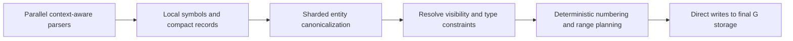

# PUBLISH: parallel parsing, canonicalization and direct G

Status: architectural proposal and implementation constraints, not an enabled
pipeline or a measured speedup. Supersedes the unfinished per-function sampling
work. The tested publish-timeline mode from 38 is retained. No Local G is proposed.

The first isolated executable experiment is now implemented as CANONICALIZER-01;
see CANONICALIZER_01.md and experiments/canonicalizer-01/. It checks the model,
shared numbering and captured real streams. It does not approve this ADR or
select a final PUBLISH architecture.

## 1. Three operations, three contracts

Separate the following operations, which the current Parser interleaves:

1. Parse grammar and represent declarations/references locally.
2. Bind a reference to the declaration/entity visible at its semantic position.
3. Assign that entity its final dense Project-local identity_ref number.

Binding does not intrinsically require the final number. A local symbol handle
or canonical representative can identify an entity before final numbering.
However, a syntactic reference cannot be called semantically resolved until
the relevant visibility/type constraints have been checked.

The existing identity_space already uses parent + kind + string_id; it does
not construct fully qualified name strings. identity_ref is four bytes:
two kind bits and a 30-bit slot. resolve assigns size()+1 on first insertion.
The global first-insertion sequence is shared across kinds. Replacing that
table with the same hierarchical key alone is not a new algorithm.
This key describes the currently supported identity model; extending the
language with additional entity categories can require additional discriminators.

## 2. What can and cannot be independent

Workers can independently create compact local symbols, spelling views and
records for the supported Header/Source grammar. Name storage remains owned
by the immutable input/token arena until its final consumer finishes. A view
must carry length through its token reference; an offset alone is insufficient.
Use the existing file_id for physical ownership. File identity never enters
the semantic entity key.

Local binding is valid when the worker possesses the required context. A
forward declaration can supply a local symbol before its definition or global
number exists. A reference requiring context outside the worker becomes an
explicit unresolved binding request or a suspended dependency, not a guessed
WHO. Complete the semantic check once that context is available; do not run
a second parser over the source text.

For Header, the work unit includes a preprocessing/root context and ordered
include expansion, not just a physical file. A header reached under two macro
environments can produce different declarations. This context affects the
work/cache key; it does not split the semantic WHO of the same scoped entity.
The physical file dependency graph also need not be an acyclic graph.

The current Header parser consults type identities while parsing types and
declarators. It cannot be made context-free merely by replacing identity_ref
with a wider integer. Deferred records must cover those decisions explicitly
or the worker must obtain a valid read-only context before proceeding.

## 3. Necessary global agreement

The combination of these requirements needs agreement across intersecting work:

- Equal semantic keys must denote the same entity.
- Unequal keys must not collide.
- Finite compact slots must be assigned consistently across workers.
- Legacy byte parity must retain the existing deterministic numbering order.

A fixed-width hash is a routing/fingerprint mechanism. Since arbitrary names
outnumber the finite slot range, it cannot establish collision-free identity
by itself. Atomic allocation provides unique slots but assigns different
numbers when worker completion order changes. Sorting full keys can provide
determinism but gives a different ordering from legacy first insertion.

With legacy numbering, the slot of an entity is the rank of its first canonical
creation event among distinct entities. Identifying duplicate keys and knowing
which earlier events created distinct entities requires information across
the workers processing those events. Preassigned disjoint ranges do not solve
cross-range duplicates without reconciliation or later remapping.

This is a necessity of information exchange, not a proof that a centralized
table, mutex per token or whole-project barrier is necessary. Agreement can
be sharded and pipelined. There is no hardware-independent minimum in
milliseconds established by this argument. At least the candidate records
and resulting mappings must be processed; real latency must be measured.

Sparse hash-derived slots are also a representation change: current Graph
identity_locations and persisted identity records use dense slot indexing.
Keeping a 32-bit field does not by itself preserve the storage cost or lookup
contract if the slot space becomes sparse.

## 4. Proposed data path

These are logical responsibilities, not mandatory project-wide barriers.
Ready chunks can move downstream while later chunks are still being parsed.
Binding and canonicalization can also request information from each other;
the diagram is a data path, not a promise of independent one-way stages.

### Local symbols

Each worker uses local numeric references and references into existing token
storage. Keep declaration events separate from reference-use events: equal
spelling does not establish equal binding under shadowing or different scopes.
Records contain semantic flags, type/construction operands and source positions
needed for direct final emission. They are neither a second G nor persisted
Graph records with prematurely allocated WHERE handles.

Distinguish physical source location from semantic event order. Repeated
include expansions can reuse the same physical file and byte offset. The
event order needs phase, root ordinal and ordered expansion/emission position.
Numbering events must reproduce actual legacy identity creation events, not
assume every mention of a name creates an identity.

### Sharded canonicalization

Canonicalize a child against its already-equated parent representative, kind
and exact name bytes. Reuse an existing lexical fingerprint when helpful;
always verify equality on matching fingerprints. Store each declaration's
earliest semantic event and all necessary compatibility obligations.

Route by the complete key, not solely by parent scope: otherwise a large set
of root-namespace declarations becomes one shard. The parent representative
need not be the final packed identity_ref. Local forwarding/remap arrays can
refer to a stable representative until numbering is complete.

Measure three interchangeable kernels on identical inputs: sort/unique,
partitioned exact-key indexing and hierarchical merging. Common outputs are
equivalence classes, earliest events and remap arrays. No kernel may skip
visibility or duplicate-definition validation and call that a speedup.

### Binding and visibility

Resolve references against the environment visible at their semantic event.
An entity found in the completed global set is not necessarily visible at an
earlier use. For example, `a.value=1; T a;` must still fail at the first use.
Reopened namespaces unify, local shadows remain distinct, and forward
declarations obey the supported language rules. Definition compatibility,
extern completion, type requirements and access/path rules remain obligations.

The initial Source implementation can use the completed immutable Header type
domain. Streaming workers must not read a live Graph vector while another
worker grows it: const graph& alone is not an immutable catalog. Source can
also append derived types, so freezing only the object catalog is insufficient.
Use explicitly stable published chunks or a genuinely frozen type view.

### Deterministic numbering

After equality and visibility are known for a committed input prefix, order
new representatives by their earliest legacy creation event and allocate a
dense range using counts/prefix sums. Existing baseline IDs remain fixed for
BUILD; this proposal initially targets PUBLISH only.

For a streaming implementation, workers publish completed chunks and progress
watermarks. Finalize a prefix only when no unfinished earlier work can introduce
an earlier creation event. Parsing and canonical key work on later chunks may
continue. Measure the delay imposed by this ordered frontier; do not assume
that a streaming design eliminates serial dependencies.

String numbering is a separate parity obligation. Dropping names that legacy
String Table retained, or changing their first-intern order, can alter all
subsequent string IDs and compiled bytes even if semantic WHO equivalence is
correct. Resolve strings late, but preserve legacy inventory/order when byte
parity is required. Removing unused strings needs an explicit separate contract
change; it is not a free part of this design.

### Direct G

Plan counts and nonoverlapping final ranges, allocate final storage once, then
scatter validated/remapped records into those ranges. Build required indexes
from the final records. Current graph::add_* APIs append to shared vectors and
indexes; concurrent calls are not the implementation of this scatter plan.

Conflicting definitions and writes require ordered reconciliation. Initializer
replacement must preserve the first target slot, the last valid value and
every required warning in original order. Source Map ownership/contributions
and the earliest error remain deterministic. Disjoint record ranges alone do
not prove that semantic writes commute.

The final data may be scattered in parallel after these obligations are known.
Operations with unresolved cross-chunk dependencies remain pending. Avoid
materializing full Local G and then copying it; the remapped record should be
written into final storage once.

## 5. Cost and experiment plan

With full barriers, the user's worker + canonicalize + G + publication sum is
a useful model. With overlap, measure the actual critical path: worker service,
canonicalization throughput, ordered-frontier stalls, final emission and drain.
Do not sum overlapping spans. Keep persistence, runtime publication and transient
destruction in the full PUBLISH endpoint (timeline mode from 38).

The current UnitProXL artifact has 161,612 identities and 188,630 strings, versus
millions of token/name occurrences. Agreement on distinct entities is therefore
a different workload from synchronization on every token. These counts do not
measure binding cost or prove that a parallel canonicalizer is cheap.

First executable experiment should isolate the canonicalization contract:

1. Capture or construct local symbol/declaration streams with local parent
   references, exact spelling views, use positions and legacy creation events.
2. Implement one correct serial reference canonicalizer with deterministic maps.
3. Run the three kernels on the same streams, including cross-worker duplicates,
   nested scopes, shadowing, include contexts and adversarial hash collisions.
4. Compare exact entity maps and final numbering against the reference under
   shuffled chunk completion orders and different worker counts.
5. Measure input/output work, exchange bytes, peak memory, barrier/frontier
   waiting and total canonicalization latency. A kernel replay is not a PUBLISH
   benchmark and cannot validate name binding or the full parser by itself.
6. Integrate context-aware compact records and direct G ranges, then validate
   complete PUBLISH byte parity, warnings, first errors and lifetime/teardown.

The invariant is global semantic correctness and deterministic output; where
canonicalization executes is an implementation choice. The practical target
is agreement per distinct key/chunk, with overlap, rather than a shared lookup
or lock for every token. No speedup or subsecond result is claimed by this ADR.

## 6. Workspace validation

The interrupted sampling additions were archived under
build/publish-parallel-design-39/abandoned-sampling/ and removed from production
sources. Rebuilt the publish benchmark, frontend and compiled-project tests;
all 22 CTest tests passed. A final PUBLISH retained both golden artifact hashes
and passed the independent baseline audit. That final call is a correctness
check, not a controlled performance comparison. This ADR does not implement
the parallel canonicalizer or change identity/Graph formats.
