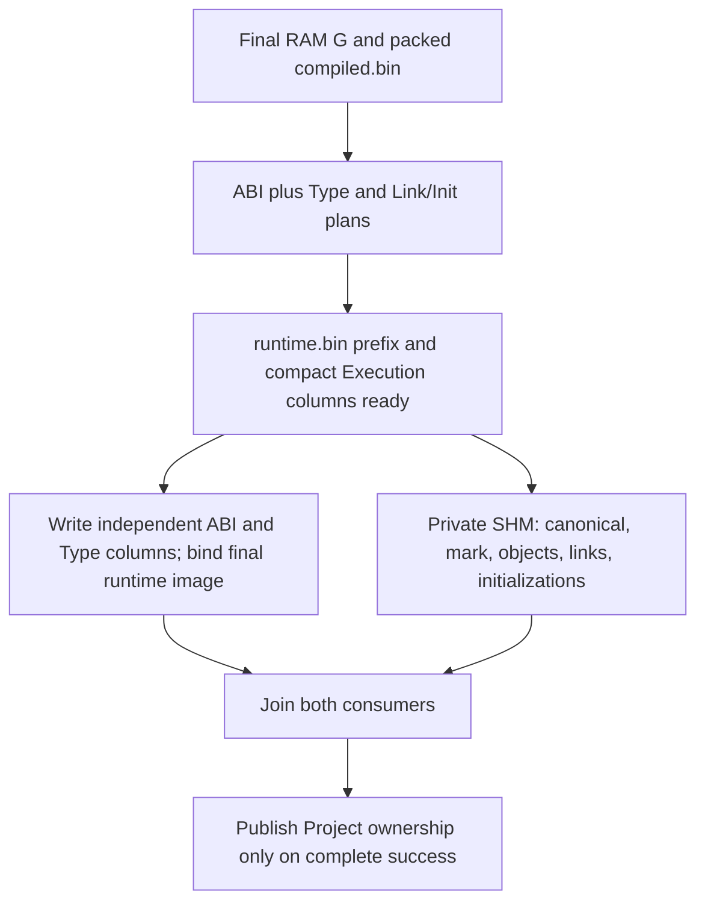

# PUBLISH-PIPELINE-01 — experimental, no adoption

**Execution-mode correction (2026-10-26):** these timings were obtained inside
the default tool sandbox. A same-binary crossover identifies a large sandbox
execution cost, chiefly in acquisition/lexical preparation. These absolute
results and pipeline conclusions must be scoped to that environment; an
unsandboxed pipeline experiment has not been performed. Historical/current V2
controls outside sandbox are effectively equal in the later A/B/C series. See
`docs/PUBLISH_UNITPROXL_ABC_01.md`. The historical calibration's statement that
the environment cause was unknown predates this follow-up.

**Result:** overlap is implemented and content parity passes, but a reliable full-UnitProXL native PUBLISH win is not established. Active production sources are unchanged: RAM G + packed encoder remain the baseline. Direct mmap v27 is not restored.

## Controlled compact variant

One prepared Type plan is moved into the execution owner without copying operation vectors. Compact Link/Init columns are encoded once into runtime.bin, attached for execution, and their original producer vectors released before SHM. ABI layout remains immutable. The existing physical-plan lane pool is reused for the two consumers.

Both link marking and object construction retain the baseline 24 lanes on UnitProXL. Type operations are read from their one owning prepared plan; Link/Init operations are read directly from their final immutable mapped columns. There is no second complete operation model, new semantic cache, parser change or Type-plan preparation during Source.

Writer read/write set: native ABI/Type plan (read-only), runtime.bin ABI sections 34..43 and Type sections 49..65 (writes). Consumer read set: the same immutable native layout/Type plan plus completed Execution sections 44..48; writes target SHM and separate mutable link-resolution scratch. The directory is finalized before either consumer starts. The consumer never reads incomplete ABI/Type file sections. The producer releases its completed G mapping before opening the resident G mapping; all prepared operations are detached from G.

## Three arms and measurement protocol

- `baseline`: original sequential persistence, then mmap attach and resident creation.
- `serial`: identical prepared-plan reuse and compact-section staging, but the remaining writer and SHM consumer execute sequentially.
- `overlap`: the same prepared-plan path with the remaining writer and resident consumer running concurrently.

One frozen Windows x64 MSVC 19.51 Release `/O2` + IPO `/GL`/`/LTCG` executable is used for all arms; no PGO. Date: 2026-10-26. Two warmups per arm, then 15 rotating/reversed three-arm blocks on each corpus, separately for native `publish` and coarse `publish-timeline`. No concurrent builds/tests during timing; no samples removed. Native resident execution has telemetry disabled. Source, binary and input hashes are rechecked after all runs.

Bootstrap intervals below use 20,000 pair resamples, seed 1101. Positive paired gain = control faster time minus candidate time, so positive means a candidate win. Absolute timings vary with the host; intervals resample blocks and cannot remove all host drift.

## Native full PUBLISH

Full UnitProXL: **24,027 types, 137,584 objects, 367,144 links**. Synthetic mixed corpus: 10,001 types, 170,001 members, 20,000 objects, 10,000 links.

| Corpus | Baseline median, ms | Prepared serial median, ms | Overlap median, ms |
|---|---:|---:|---:|
| synthetic | 87.260 | 87.306 | 86.859 |
| unitproxl | 1840.590 | 1824.500 | 1833.360 |

| Corpus / comparison | Paired gain, ms | 95% bootstrap interval, ms | Candidate wins |
|---|---:|---:|---:|
| synthetic: baseline->serial | +0.184 | -0.751 to +3.013 | 9/15 |
| synthetic: baseline->overlap | +0.585 | +0.006 to +1.495 | 12/15 |
| synthetic: serial->overlap | +1.028 | -1.503 to +1.152 | 10/15 |
| unitproxl: baseline->serial | +8.710 | -25.990 to +35.240 | 9/15 |
| unitproxl: baseline->overlap | -2.220 | -5.880 to +22.550 | 7/15 |
| unitproxl: serial->overlap | +0.630 | -19.670 to +34.590 | 8/15 |

The full-corpus overlap-vs-baseline interval includes zero, as does overlap-vs-serial. Therefore neither the overall pipeline nor the isolated overlap contribution has a reliable native full-corpus benefit in this trial. Marginal medians and medians of paired differences need not subtract to the same number. The tiny synthetic signal is insufficient for full-project adoption.

## Historical V2 baseline calibration (1356.49 vs 1840.59 ms)

**2026-10-26 recheck:** the unchanged historical executable on its original
fixture again ran near the historical baseline: excluded warmup 1358.14 ms;
three native samples 1369.60 / 1358.27 / 1315.91 ms, median **1358.27 ms**.
Executable SHA-256 remains
`841c7848aaf4631fef25c8bf6eb28de7cac072f9b01dd66dcf0cae7b0a1adde5`;
compiled/runtime hashes match historical V2 gold after every run.
Evidence: `build/v2-baseline-recheck-20261026-132030/summary.json`.
The slower calibration below describes an earlier environment observation,
not the current reproduced timing. This short recheck does not establish
the reason for the earlier slowdown or constitute a new paired comparison.

The historical 1356.49 ms V2 figure is from PLS10-C9, not this timing series.
Both numbers use `total_ms` before resident teardown; teardown scope does not
explain the difference. Profiling series show the dominant changed interval:

| Profile median | Historical V2 series, ms | Current pipeline baseline series, ms |
|---|---:|---:|
| File acquisition + lexical preparation | 133.847 | 573.885 |
| Semantic | 797.035 | 809.591 |
| Persistence | 203.595 | 199.629 |
| Resident | 200.817 | 210.970 |

These are diagnostic phase series, not an exact additive decomposition of the
native median difference. A fresh calibration reran the **unchanged historical
PLS10-C9 baseline executable on its original fixture** in native `publish` mode:
1885.50 / 1885.42 / 1850.55 ms, median 1885.42 ms. The executable SHA-256 matches
the historical frozen hash, and both current artifact hashes match the stored
historical V2 gold hashes. On the newer common fixture the same old executable
also shows roughly 1.9 seconds and 586–677 ms acquisition/lexical preparation.

Thus a slower current File Read/Lexer interval is observed even without any
pipeline code. The historical/current absolute-time difference must not be
reported as a V2 or pipeline code regression. The precise host/OS/cache cause
has **not** been established; CPU frequency, storage and antivirus explanations
remain untested hypotheses. Use same-series paired controls for pipeline
conclusions. Calibration logs/data: `build/pipeline-baseline-diagnosis-01/`.

## What can actually overlap

UnitProXL coarse-profile medians for the overlap arm:

| Interval | ms |
|---|---:|
| Runtime image sizing/allocation/prefix before fork | 8.4907 |
| Compact Execution encode/attach/release before fork | 7.0853 |
| Remaining independent ABI/Type writer | 1.7627 |
| Resident worker, including checks and SHM | 179.8330 |
| Intersection of writer and resident-worker intervals | 1.7562 |

The overlap metric starts when the resident worker begins opening/checking G; it is **not** an isolated SHM-materialization overlap measurement. The remaining writer is only about 1.76 ms. Encoding dependent execution sections and initializing the runtime file still precede the fork. This slice cannot justify assuming a 195 ms saving from the whole Resident stage.

Profile timings are diagnostic, not the native latency baseline. Attach/preparation instrumentation differs when a prepared plan bypasses persisted attachment. Also, pipeline `persistence_ms` already includes the joined resident worker; adding `pipeline_resident_ms` would double count overlapping work. Only `persistence_ms + resident_ms` (resident_ms is zero on the prepared path) is a comparable combined wall interval.

| UnitProXL profile metric | Baseline | Prepared serial | Overlap |
|---|---:|---:|---:|
| Persistence + resident wall, ms | 411.089 | 379.781 | 380.781 |
| Link mark lanes | 24.000 | 24.000 | 24.000 |
| Object lanes | 24.000 | 24.000 | 24.000 |

## Memory and files

| UnitProXL native metric | Baseline | Prepared serial | Overlap |
|---|---:|---:|---:|
| Peak working set, MB | 2571.915 | 2604.569 | 2604.167 |
| Peak private commit, MB | 625.025 | 624.001 | 625.689 |
| compiled.bin, MB | 151.295 | 151.295 | 151.295 |
| runtime.bin, MB | 67.298 | 67.298 | 67.298 |

MB = 1,000,000 bytes. Peak private commit uses Windows PeakPagefileUsage; working set includes file mappings and SHM and is not interchangeable with private commit. File sizes and complete file bytes match across arms. Peak working set increases by roughly 32 MB in the overlap arm; private commit is essentially unchanged.

## Correctness, dependencies and failures

- 73 functional checks cover enum/inheritance, scalar/extern completion, char arrays, nested objects/arrays, repeated final reference binding and constructors; parser/extern errors, reserved System and reference cycles; serial fallback; and injected plan, file creation, map, ABI/Type/Execution, compact setup, resident, post-SHM and pre-publication failures.
- Failure checks run a same-process probe: output must remain null, all artifacts must be absent, and the same named SHM at the same fixed VA must be creatable again. Post-SHM/pre-publication failures require that the private consumer actually completed successfully first. This checks release before process exit, not merely OS cleanup on exit.
- All timing runs compare SHA-256 of the complete compiled.bin and runtime.bin outside the operation timer. Warmup PUBLISH, cold audit and repeat LOAD compare raw SHM SHA-256 across every arm before/after each series. Cold audit calls verify_contents().
- Publication is a private staged Project pointer until both consumers join, runtime.bin structural bind succeeds and SHM finishes. No partially built Project pointer reaches the caller. On either consumer failure, staged ownership is destroyed before the existing artifact cleanup.
- Fixed SHM VA/range checks and canonical -> mark -> objects -> links -> initializations order are unchanged. No SHM relocation after native references are installed. Since G is final before the experiment starts, subsequent Source writes cannot invalidate early materialization.
- REBUILD and LOAD never opt into the staged construction path. PUBLISH durable flush remains disabled. No change is made to file formats, parser dispatch, WHO/WHERE numbering or SourceMap.

## Retained first pilot (owned execution)

The first single-plan implementation used the existing owned-plan executor, which falls back to one link-mark lane rather than baseline 24. It passed 71 functional checks, exact file/SHM parity and 180 timed observations, but was not a clean concurrency-only comparison. Its full UnitProXL native baseline->overlap paired gain was -16.70 ms (95% interval -46.28..-4.43 ms). It is retained under `build/publish-pipeline-01-final/` and is not silently excluded or mixed with the controlled compact results.

The controlled compact variant above restores the identical 24-lane link marking and object executor and adds a matched serial control. No further architecture changes or Source-overlap stage were attempted after the controlled result failed to establish a full-corpus win.

## Artifacts and reproduction

Implementation/reproduction instructions: `experiments/publish-pipeline-01/README.md`.

Controlled data: `build/publish-pipeline-01-compact/`:

- `summary.json`, `samples.json`, `samples.csv`, `run.log`, `timing-logs/`: all 180 timed observations, intervals and stdout/stderr.
- `functional-results.json`, `functional.log`, `functional-logs/`, `checks.json`, `parity.json`: functional/failure checks, 36 warmup/audit/LOAD checks and hashes.
- `source/`, `source-manifest.json`, `snapshot.json`, `build*.log`, `binary.json`, `binaries/PublishPipeline01.exe`: exact source/build/binary provenance.
- `input-manifest.json`, `host.json`: common immutable input hashes and host information.

Active engine/CMake tracked changes remain exactly the pre-existing production-PGO CMake block and Source endpoint resolver edits. All pipeline code lives under the standalone experiment/private generated sources; there is no default production enablement to roll back.
